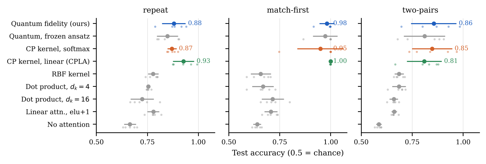
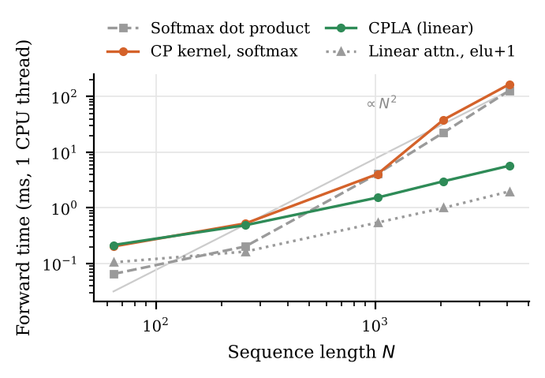
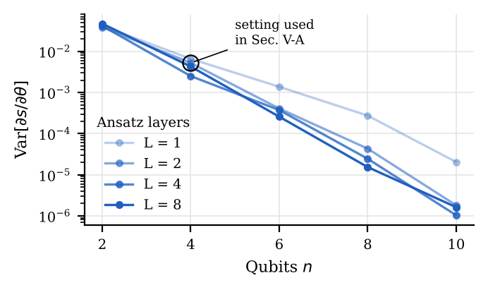
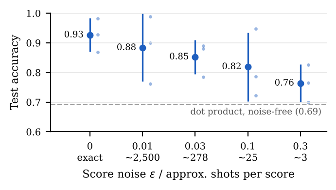

# From Quantum Fidelity to Linear-Time Attention

**An Exact Classical Reduction of Quantum Self-Attention**

Chandra Sekhar Singuru · Independent Researcher · [ORCID 0009-0004-0219-1960](https://orcid.org/0009-0004-0219-1960)

📄 Paper (IEEE conference format): [`paper/Quantum_Fidelity_Linear_Attention.pdf`](paper/Quantum_Fidelity_Linear_Attention.pdf)

---

## Summary

Quantum self-attention models replace the Transformer's dot-product score with the fidelity between quantum states that encode two tokens. This project asks where their reported accuracy gains come from, and whether they need a quantum computer.

- **Exact classical reduction.** For angle-encoded states, the quantum fidelity score equals a classical **cosine-product (CP) kernel**, and any fidelity-based attention is an inner product of explicit `4^n`-dimensional features.
- **CPLA: a linear-time attention layer.** The reduction yields cosine-product linear attention, a classical layer whose cost grows linearly with sequence length.
- **Controlled experiments.** Nine attention variants are compared, including a quantum layer built on the Qiskit Estimator primitive with exact parameter-shift gradients.

## Key results

| Finding | Evidence |
|---|---|
| Quantum attention beats dot-product attention on token-matching tasks by 0.13–0.31 accuracy | 3 tasks × 5 seeds (`results/accuracy*.csv`) |
| A classical CP kernel matches the quantum layer within seed variance | paired per-seed comparison |
| CPLA matches or exceeds the quantum layer on 2 of 3 tasks, ~22× faster than softmax attention at 4,096 tokens | `results/timing.csv` |
| Wider dot-product and standard linear attention do not close the gap | `results/accuracy_v2.csv` |
| On SST-2 sentiment, dot-product attention is best; CP-kernel layers trail by 1.2–2.4 points | `results/sst2.csv` |
| Gradient variance of the quantum layer falls ~10,000× from 2 to 10 qubits | `results/gradient_variance.csv` |

<!-- RESULTS:START -->
## Reproduced results

All numbers below are generated from `results/*.csv` by `scripts/summarize.py`, after a full run of `scripts/reproduce.sh` from a fresh clone of this repository. Values are mean ± standard deviation over seeds.

**Reproducibility check (2026-10-10):** re-running everything from a fresh clone reproduced all synthetic, gradient, qubit, noise and validation results bit-for-bit (199 of 199 rows). The SST-2 runs of the CP kernel with softmax shifted by under 0.01 because its code now uses an algebraically identical matrix-product form that rounds differently in float32; the tables and paper use the reproduced values. Timings vary with hardware.

### Tests

```
............                                                             [100%]
12 passed in 1.86s
```

### Token-matching tasks (5 seeds)



| Attention layer | repeat | match-first | two-pairs | Attn. params |
|---|---|---|---|---|
| Quantum fidelity (ours) | 0.879 ± 0.058 | 0.981 ± 0.036 | 0.855 ± 0.111 | 629 |
| Quantum, frozen ansatz | 0.848 ± 0.052 | 0.972 ± 0.060 | 0.810 ± 0.101 | 613 |
| CP kernel, softmax | 0.870 ± 0.022 | 0.949 ± 0.113 | 0.847 ± 0.099 | 613 |
| **CPLA** (linear, ours) | 0.927 ± 0.052 | 0.999 ± 0.002 | 0.809 ± 0.086 | 612 |
| RBF kernel | 0.778 ± 0.026 | 0.656 ± 0.049 | 0.686 ± 0.022 | 681 |
| Dot product, d_k=4 | 0.754 ± 0.009 | 0.667 ± 0.053 | 0.685 ± 0.034 | 680 |
| Dot product, d_k=16 | 0.725 ± 0.057 | 0.715 ± 0.054 | 0.659 ± 0.021 | 1088 |
| Linear attention, elu+1 | 0.779 ± 0.029 | 0.707 ± 0.032 | 0.661 ± 0.013 | 1088 |
| No attention | 0.664 ± 0.029 | 0.638 ± 0.019 | 0.586 ± 0.013 | 0 |

### SST-2 sentiment (5 seeds, test accuracy at best dev epoch)

| Attention layer | Dev | Test | Attn. params |
|---|---|---|---|
| Dot product, d_k=16 | 0.772 ± 0.006 | 0.777 ± 0.008 | 10400 |
| Linear attention, elu+1 | 0.775 ± 0.013 | 0.772 ± 0.007 | 10400 |
| Dot product, d_k=4 | 0.778 ± 0.012 | 0.772 ± 0.010 | 8840 |
| CP kernel, softmax | 0.763 ± 0.009 | 0.759 ± 0.008 | 8581 |
| **CPLA** (linear, ours) | 0.764 ± 0.011 | 0.756 ± 0.008 | 8580 |
| Quantum, frozen ansatz | 0.764 ± 0.014 | 0.755 ± 0.008 | 8581 |
| Quantum fidelity (ours) | 0.761 ± 0.012 | 0.753 ± 0.008 | 8597 |
| No attention | 0.715 ± 0.017 | 0.717 ± 0.015 | 0 |

### Speed (one attention layer, d = 64, 1 CPU thread, median of 5)

At 4,096 tokens CPLA is **22.5× faster** than softmax dot-product attention.



| N (tokens) | Softmax dot product (ms) | CP kernel, softmax (ms) | Quantum (simulated) (ms) | CPLA (linear) (ms) | Linear, elu+1 (ms) |
|---|---|---|---|---|---|
| 64 | 0.07 | 0.20 | 1.67 | 0.21 | 0.10 |
| 256 | 0.20 | 0.53 | 3.41 | 0.49 | 0.16 |
| 1,024 | 4.12 | 4.06 | 10.74 | 1.53 | 0.55 |
| 2,048 | 22.60 | 38.45 | 51.04 | 3.01 | 1.00 |
| 4,096 | 129.07 | 167.37 | 181.30 | 5.73 | 1.98 |

### Trainability of the quantum layer



Gradient variance at random parameters:

| Qubits n | L = 1 | L = 2 | L = 4 | L = 8 |
|---|---|---|---|---|
| 2 | 4.14e-02 | 3.88e-02 | 4.18e-02 | 4.71e-02 |
| 4 | 6.58e-03 | 5.23e-03 | 2.50e-03 | 4.27e-03 |
| 6 | 1.37e-03 | 4.07e-04 | 3.73e-04 | 2.58e-04 |
| 8 | 2.74e-04 | 4.30e-05 | 2.44e-05 | 1.53e-05 |
| 10 | 2.03e-05 | 1.80e-06 | 1.03e-06 | 1.62e-06 |

Two-pairs accuracy vs register size (3 seeds):

| Qubits n | Quantum | Dot product (d_k = n) |
|---|---|---|
| 2 | 0.790 ± 0.073 | 0.669 ± 0.053 |
| 4 | 0.926 ± 0.057 | 0.693 ± 0.010 |
| 6 | 0.736 ± 0.017 | 0.710 ± 0.045 |
| 8 | 0.806 ± 0.097 | 0.664 ± 0.044 |

### Robustness to shot noise (two-pairs, 3 seeds)



| Noise ε | ≈ shots per score | Test accuracy |
|---|---|---|
| 0.0 | exact | 0.926 ± 0.057 |
| 0.01 | ~2,500 | 0.883 ± 0.114 |
| 0.03 | ~278 | 0.852 ± 0.058 |
| 0.1 | ~25 | 0.819 ± 0.116 |
| 0.3 | ~3 | 0.764 ± 0.063 |

### Simulator vs. Qiskit Estimator

| (qubits, layers) | Max score error | Max gradient error |
|---|---|---|
| (2, 1) | 1.4e-16 | 7.8e-16 |
| (2, 2) | 2.2e-16 | 4.2e-16 |
| (3, 2) | 8.3e-17 | 3.3e-16 |
| (4, 2) | 8.3e-17 | 3.3e-16 |
| (6, 3) | 4.2e-17 | 6.9e-17 |
<!-- RESULTS:END -->

## Repository layout

```
src/
  quantum_attention.py   Qiskit reference layer: Estimator V2, parameter-shift autograd, checks
  experiments.py         exact statevector simulator, synthetic tasks, gradient/qubit/noise studies
  exp2.py                CPLA, wider baselines, SST-2, timing
results/                 raw CSVs behind every number in the paper
paper/                   IEEEtran LaTeX source, BibTeX, figure script, figures, compiled PDF
scripts/                 data download, full reproduction, README results generator
tests/                   correctness tests (simulator vs Qiskit, gradients, Propositions 1–2, CPLA)
assets/                  PNG figures shown in this README
```

## Reproduce

```bash
pip install -r requirements.txt
bash scripts/download_sst2.sh        # SST-2 sentence split (6,920 / 872 / 1,821)
bash scripts/reproduce.sh            # tests, all experiments, figures, README tables and the PDF (~1–2 h on a laptop CPU)
```

Individual steps:

```bash
python -m pytest -q tests/                                               # correctness tests (seconds)
python src/quantum_attention.py                                          # Qiskit layer demo + checks
python src/experiments.py validate gradvar accuracy kernels qubits noise
python src/exp2.py check synthetic sst2 timing
(cd paper && python make_figures.py)
python scripts/summarize.py logs/tests.txt                               # refresh README results
(cd paper && latexmk -pdf paper.tex)
```

Timing depends on hardware; run it on an otherwise idle machine. The simulator in `experiments.py` is validated against the Qiskit implementation to within 1e-15 in scores and gradients.

## Citation

If you use this work, please cite it (see also [`CITATION.cff`](CITATION.cff)):

```bibtex
@misc{singuru2026fidelity,
  author = {Singuru, Chandra Sekhar},
  title  = {From Quantum Fidelity to Linear-Time Attention: An Exact Classical Reduction of Quantum Self-Attention},
  year   = {2026},
  howpublished = {\url{https://github.com/Chandra953/Quantum-Fidelity-Attention}}
}
```

## Disclosure

Generative AI tools assisted with code development, experiment design and drafting. The author reviewed, verified and takes responsibility for all content.

## License

Code is released under the MIT License (see [`LICENSE`](LICENSE)). The paper text and figures are © 2026 Chandra Sekhar Singuru.
